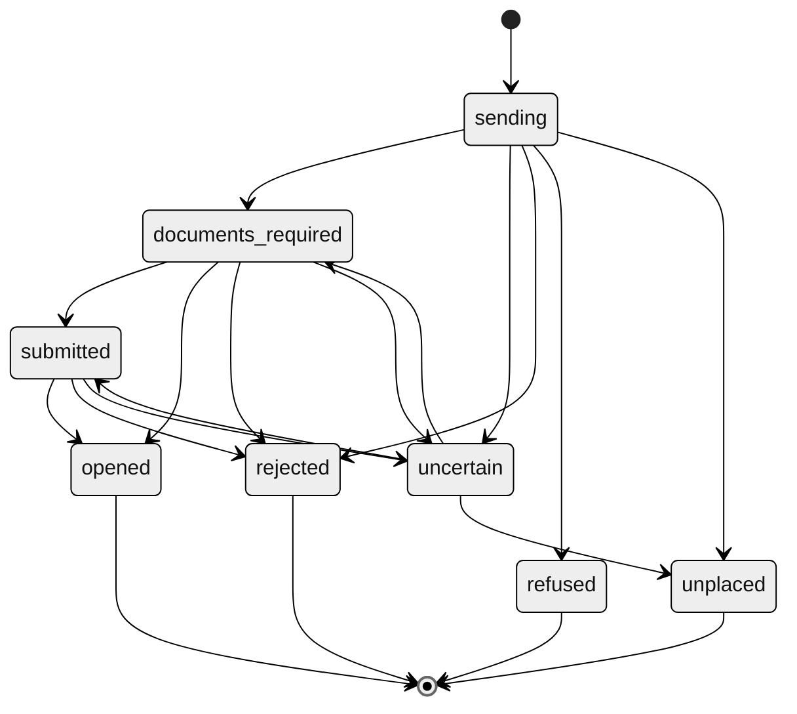

<!-- Generated by scripts/generate.py from the Matamba Gateway partner docs. Do not edit: change the docs and run the script. -->

# Open an account

Source: <https://docs.matambaintelligence.com/applications>

You open a brokerage account for a customer by sending an application, then the customer's four documents. We pass both to the broker, which reviews them and opens the account. When it opens, you receive the account code, and you can fund it and trade for it.

## Who can have an account

An account is for one person who lives in Nigeria and is Nigerian. We send every application to the broker as an individual's, with Nigeria as the country of residence and the nationality: the only value the broker publishes for each. The API doesn't open joint accounts or accounts for companies.

The broker specifies no minimum age and decides each application: a refusal comes back as one of the [application reject reasons](https://docs.matambaintelligence.com/errors#application_reject_reasons), or as `uncertain` if the broker gives a reason it doesn't publish.

## Your customer's identity

Know your customer (KYC) checks are yours: you check your customer's identity before you apply, as your own obligations require. You send the customer's four documents after the application: see [Send the documents](https://docs.matambaintelligence.com/applications#send-the-documents). The broker checks the BVN, and refuses one it can't accept with `invalid_field`.

## 1. Look up the codes

Four fields take a code from the broker's lists, not free text:

| Field | Codes from |
|---|---|
| `state` (where the customer lives) and `state_of_origin` | `GET /v1/reference/states` |
| `lga_of_origin` | `GET /v1/reference/states/{state}/lgas`, for the customer's state of origin |
| `bank` (the customer's own bank) | `GET /v1/reference/banks` |

## 2. Send the application

Send `POST /v1/applications` with a new [`Idempotency-Key`](https://docs.matambaintelligence.com/idempotency). In the sandbox, change `bvn` and `email` first: see [In the sandbox](https://docs.matambaintelligence.com/applications#in-the-sandbox).

```http Request
POST /v1/applications
Authorization: Bearer $KEY
Content-Type: application/json
Idempotency-Key: app-0001

{
  "first_name": "Ada",
  "last_name": "Example",
  "gender": "F",
  "date_of_birth": "1990-01-15",
  "email": "ada@example.com",
  "phone": "08000000000",
  "street": "1 Example Street",
  "city": "Ikeja",
  "state": "LA",
  "postcode": "100001",
  "state_of_origin": "LA",
  "lga_of_origin": "LA-IKJ",
  "next_of_kin_name": "Ben Example",
  "next_of_kin_phone": "08000000001",
  "bank": "058",
  "bank_account_name": "Ada Example",
  "bank_account_number": "0000000000",
  "bank_account_opened": "2015-06-01",
  "mothers_maiden_name": "Example",
  "bvn": "12345678901"
}
```

```bash cURL
curl -X POST https://$HOST/v1/applications \
  -H "Authorization: Bearer $KEY" \
  -H "Content-Type: application/json" \
  -H "Idempotency-Key: app-0001" \
  --data-binary @- <<EOF
{
  "first_name": "Ada",
  "last_name": "Example",
  "gender": "F",
  "date_of_birth": "1990-01-15",
  "email": "ada@example.com",
  "phone": "08000000000",
  "street": "1 Example Street",
  "city": "Ikeja",
  "state": "LA",
  "postcode": "100001",
  "state_of_origin": "LA",
  "lga_of_origin": "LA-IKJ",
  "next_of_kin_name": "Ben Example",
  "next_of_kin_phone": "08000000001",
  "bank": "058",
  "bank_account_name": "Ada Example",
  "bank_account_number": "0000000000",
  "bank_account_opened": "2015-06-01",
  "mothers_maiden_name": "Example",
  "bvn": "12345678901"
}
EOF
```

```http Response
HTTP/1.1 201 Created

{
  "object": "application",
  "id": "app_3rbw6yq2kd5mz7tcxf4n",
  "state": "documents_required",
  "reference": "KYC1790315920417",
  "account": null,
  "reason": null,
  "reject_reason": null,
  "param": null,
  "created_at": "2026-09-25T05:58:40Z",
  "updated_at": "2026-09-25T05:58:40Z",
  "client_reference": null
}
```

Every field's rules are in the [API reference](https://docs.matambaintelligence.com/api-reference/applications/apply-for-an-account). Before we send anything, we check the body and the form of each field:

| What's wrong | Response |
|---|---|
| A required field is missing. | `400 missing_required_field`, with `param` naming the field. |
| A field breaks its rule, such as a date of birth in the future. | `400 invalid_request`, with `param` naming the field. |
| A field has the wrong JSON type, isn't a recognised field, or appears twice. | `400 invalid_request`, with no `param`. The message names the field. |

Then the broker checks the application. It publishes these formats:

| Field | Format the broker publishes |
|---|---|
| `gender` | `M` or `F`. |
| `date_of_birth`, `bank_account_opened` | `yyyy-MM-dd`. |
| `state`, `state_of_origin`, `lga_of_origin`, `bank` | A code from its lists. |
| `email`, `bank_account_number`, `bvn`, `nin` | None, though it can refuse one as invalid. |
| `mothers_maiden_name` | None. Its request marks the field optional, yet it refuses an application without one, so we require it. |
| `phone`, `next_of_kin_phone` | A Nigerian number without its country code, `0` and 10 digits. You can also write `+234` and the same 10 digits: we send it to the broker as `0` and 10 digits. We refuse any other number with `400 invalid_request`, `param` naming the field. |
| Names and addresses | None. It refuses one only when it's missing. |
| `postcode` | None, and it publishes no refusal for it. |
| `middle_name`, `next_of_kin_relationship`, `next_of_kin_address`, `tax_id` | None, and it publishes no refusal for them. We send each one only if you do. |

Where the broker publishes no format, we send the field as you write it, trimmed of spaces at each end, so check it before you send.

When the broker refuses one field, you get `422 application_rejected` with `reject_reason` `invalid_field` and `param` naming the field. When it refuses the application as a whole, `reject_reason` is `rejected_by_broker` and there's no `param`. An error never repeats a field's value.

If the broker refuses an application with a reason it doesn't publish, we record it as `uncertain`, and our operations team reconciles it with the broker. An uncertain application the broker does not hold ends `unplaced`: [contact us](https://docs.matambaintelligence.com/support) with its `id` before you send it again.

## 3. Read the answer

| Response | Recorded as | What to do |
|---|---|---|
| `201` | `documents_required` | The broker has it, and `reference` is its reference. Send its four documents: see [Send the documents](https://docs.matambaintelligence.com/applications#send-the-documents). |
| `201` | `uncertain` | Wait. The broker did not confirm receipt, and it is being reconciled with the broker. Don't send it again under a new key: if the broker has the first, it refuses the second as a duplicate. Once it becomes `documents_required`, send its documents. |
| `422 application_rejected` | `rejected` | Read `reject_reason` and `param`. For `invalid_field`, correct that field and send the application with a new key. For the other reasons, see [Application reject reasons](https://docs.matambaintelligence.com/errors#application_reject_reasons). |
| `503 application_not_sent` | `refused` | It never reached the broker. Send it again with a new key. |
| `503 outcome_not_recorded` | `sending` | Its outcome was not recorded. Retrieve the application the error's `application` names until it resolves. Don't send it again under a new key: if the broker has the first, it refuses the second as a duplicate. |

Every other refusal, and whether each one stored your key, is in [Idempotency](https://docs.matambaintelligence.com/idempotency#when-to-use-a-new-key).

If a corrected application comes back `already_at_broker`, don't send it again: [contact us](https://docs.matambaintelligence.com/support) with the `id` of each application. The broker doesn't specify whether it keeps an application it refused. The sandbox's broker doesn't, so there a corrected application with the same BVN is accepted.

## Send the documents

The broker needs four documents before its staff can review an application. Send each once the application is `documents_required`, one request each, in any order, with the file itself as the body. We take them while it's `submitted` too, once all four are there: sending one of them again is how you check it. `$APPLICATION_ID` is the application's `id`:

```http Request
PUT /v1/applications/$APPLICATION_ID/documents/government_id
Authorization: Bearer $KEY
Content-Type: image/jpeg

(the file's bytes)
```

```bash cURL
curl -X PUT https://$HOST/v1/applications/$APPLICATION_ID/documents/government_id \
  -H "Authorization: Bearer $KEY" \
  -H "Content-Type: image/jpeg" \
  --data-binary @government_id.jpg
```

Send the file with `--data-binary`: `-d` changes its bytes. The answer is the document:

```http Response
HTTP/1.1 200 OK

{
  "object": "document",
  "application": "$APPLICATION_ID",
  "type": "government_id",
  "state": "delivered",
  "created_at": "2026-10-01T09:15:04Z",
  "updated_at": "2026-10-01T09:15:04Z"
}
```

| `type` | The document |
|---|---|
| `photo` | A passport photograph |
| `government_id` | A government-issued ID |
| `utility_bill` | A utility bill, for the address |
| `signature` | A specimen of the customer's signature |

Each must be a whole JPEG or PNG, sent with the `Content-Type` of what it is (`image/jpeg` or `image/png`), smaller than 1,000,000 bytes and at most 8,000 pixels wide and high. A PDF is refused with `415 unsupported_media_type`: convert it to an image first. The broker doesn't publish what each document must show, or how it wants a card with two sides; if its staff can't use one, we tell you. We check each file, send it to the broker in the same request, and keep no copy.

At most two of your documents are on their way to the broker at once, and four across all partners: send the four one or two at a time. One more is answered `429 rate_limited` before its body is read.

Before you send:

- Keep each file, byte for byte, until it's `delivered`. An answer we couldn't confirm is settled by sending the same bytes again: a file compressed again is a different file.
- If a request times out, send the same file again. Until the first request ends, the answer is `409 document_in_flight`. The answer is the document: `delivered` once the broker has it, which doesn't mean the broker's staff have verified it. When the broker has all four, the application becomes `submitted`, with an `application.submitted` event.

| Response | What to do |
|---|---|
| `200`, `delivered` | Nothing. The same file sent again isn't sent twice, so sending it again is also how you check. |
| `503 document_unconfirmed` | Send the same file again. We send it to the broker again, and its answer settles the document. |
| `409 earlier_document_unconfirmed` | The broker's answer to an earlier file of this type was not confirmed. Send that earlier file again. To send a different file instead, [contact us](https://docs.matambaintelligence.com/support). |
| `409 document_already_delivered` | The broker has a different file of this type. [Contact us](https://docs.matambaintelligence.com/support) to replace it. |
| `409 document_in_flight` | Wait the `Retry-After` interval, then send the same file again. |
| `409 application_not_accepting_documents` | The application isn't taking documents in its state: read its `state`. If it's `uncertain` or `sending`, wait, and send them once it's `documents_required`. Nothing was sent. |
| `422 document_rejected` | The broker refused the file. Correct it and send it again; if it's refused again, [contact us](https://docs.matambaintelligence.com/support) with the application's `id` and the document's `type`. |
| `422 invalid_document`, `413 document_too_large`, `415 unsupported_media_type` | Correct the file. Nothing was sent. |
| `429 rate_limited` | Wait the `Retry-After` interval, then send it again. Nothing was sent. |
| `503 exchange_unavailable` | Send the same file again. Nothing reached the broker. |

Every other answer is in the API reference's [Send a document](https://docs.matambaintelligence.com/api-reference/applications/send-a-document): `400`, `403`, `404`, and `503` while trading is paused or our service is.

## 4. Wait for the account to open

The broker's staff review an application before the broker issues an account number, and how long that takes is set by the broker: we don't promise a time. While we can reach the broker, we check on applications waiting for their account, `documents_required` and `submitted`, about every 30 seconds. Each check asks about up to 20 applications, across all partners, the ones asked about longest ago first. We ask about each application at every check for 5 minutes after it last changed state, then less often as it waits, and at least once an hour, until the broker opens it or our operations team records its outcome. We never stop asking by ourselves: the broker's review can take days.

When the broker opens the account, we record the application as `opened`, with the account code in `account`, and you receive an `application.opened` [event](https://docs.matambaintelligence.com/webhooks) carrying it:

```json Opened application
{
  "object": "application",
  "id": "app_3rbw6yq2kd5mz7tcxf4n",
  "state": "opened",
  "reference": "KYC1790315920417",
  "account": "1000000001",
  "reason": null,
  "reject_reason": null,
  "param": null,
  "created_at": "2026-09-25T05:58:40Z",
  "updated_at": "2026-09-25T06:04:10Z",
  "client_reference": null
}
```

The account also appears in `GET /v1/accounts`, with `application` set to the application's `id`.

From the broker's answer about an application we read its account number and, when it gives none, the sentence it writes about the application: the broker doesn't publish the statuses its answer can carry, so a decline cannot be read from it. When the broker declines an application, our operations team records it as `rejected`, with `reject_reason` `declined_by_broker`.

If the broker says it holds no application under the reference it gave, or gives no account and a status we can't read, twice with the same answer and at least 10 minutes after the application last changed state, the application becomes `uncertain`, and our operations team reconciles it with the broker. Its `reason` reads `The broker says it holds no application under this reference.` or `The broker gave no account for this application and said something about it we could not read.`, each followed by `Our operations team is reconciling it with the broker.` What to do is the same for both: wait, and don't send it again under a new key. If the broker still has it, it becomes `documents_required` again, with a second `application.documents_required` event, or `submitted`, with an `application.submitted` event, when the broker has its four documents; if not, it becomes `unplaced`.

## Application states



| State | Meaning | Who moves it there | Final |
|---|---|---|---|
| `sending` | We've stored it and are sending it. You normally see it only while your request is in progress. If it still reads `sending` after its request has ended, its outcome was not recorded, and our check of waiting applications doesn't ask about it: our operations team reconciles it with the broker. It becomes `documents_required`, `submitted` or `unplaced`, the same business day, or the next if its request ended outside 9:00 to 17:00 West Africa Time (WAT), Monday to Friday. | Your request | No |
| `documents_required` | The broker has it, and needs the customer's four documents before its staff can review it. | Your request, or our operations team reconciling an uncertain one or one left `sending` | No |
| `submitted` | The broker has it and its four documents, and its staff review it. | Your fourth document, or our operations team reconciling an uncertain one | No |
| `uncertain` | The broker did not confirm receipt, or later said it holds no application under the reference it gave, or said something about it we cannot read. Our operations team reconciles it. | Your request, or our check of waiting applications | No |
| `opened` | The broker opened the account. `account` holds its code. | Our check of waiting applications | Yes |
| `rejected` | The broker refused it. `reject_reason` says why, and `param` names the field at fault, if one is. | Your request, or our operations team on the broker's word | Yes |
| `refused` | It never reached the broker. | Your request | Yes |
| `unplaced` | Our operations team confirmed the broker does not hold it: it never received it, refused it with a reason it doesn't publish, or no longer holds it. | Our operations team, reconciling an uncertain one or one left `sending` | Yes |

Each move to a state after `sending` sends an `application.<state>` [event](https://docs.matambaintelligence.com/webhooks).

## A customer the broker already knows

The broker refuses an application when its BVN or its email address already belongs to one of the broker's customers, or when its BVN matches an application the broker already holds. All three come back as `422 application_rejected` with `reject_reason` `already_at_broker`. The answer tells you the broker already knows that BVN or email address. It doesn't say which, or whether the person is a customer or an applicant.

Don't send the same application again. If your customer already has an account with the broker, we can link it to you. [Contact us](https://docs.matambaintelligence.com/support) with the application's `id`, and we tell you how to send the customer's written consent. Once the broker confirms the account is theirs, we link it to you, and you use its account code as you would any other.

## What the API doesn't do yet

An application whose documents you won't send stays `documents_required`, and we keep asking the broker about it: [contact us](https://docs.matambaintelligence.com/support) with its `id` to close it.

The API can't replace a document the broker has. To replace one, such as one the broker's staff can't use, [send us](https://docs.matambaintelligence.com/support#what-to-send-for-each-request) the application's `id` and the document's `type`, never the file, and we take it to the broker; we don't promise a time.

Once an account is open, the API can't yet change a customer's details, close the account, or move its shares to another broker. For any of these, [send us](https://docs.matambaintelligence.com/support#what-to-send-for-each-request) the account code and what you need, without the customer's personal details, and we take it to the broker.

## In the sandbox

Once its four documents arrive, an application opens at our next check, so you can follow it to `opened` and receive the event. One test value makes the broker reject an application at once instead: see [Test values](https://docs.matambaintelligence.com/sandbox#test-values). In the sandbox you can send that application again. In live, [contact us](https://docs.matambaintelligence.com/support) before you send a `rejected_by_broker` application again.

The sandbox takes any whole JPEG or PNG for a document. Never send a real customer's documents to the sandbox.

The sandbox's broker also refuses an `email` without an `@`, and a code that isn't in its lists, so you can rehearse `invalid_field` and a corrected resend. It takes any postcode, name or bank account number.

The sandbox's broker keeps the BVN and email address of every application it accepts, from every partner, until the sandbox restarts. It refuses a second application with either as `422 application_rejected` with `reject_reason` `already_at_broker`. Before you send the example above, change its `bvn` to another valid BVN that isn't all zeros (a [test value](https://docs.matambaintelligence.com/sandbox#test-values)), and its `email` to an address of your own. The [Postman collection](https://docs.matambaintelligence.com/matamba-gateway.postman_collection.json) does this on each run.

## Then fund the account

Once the account is open, allocate money to it from your wallet. See [Fund an account](https://docs.matambaintelligence.com/funding).
