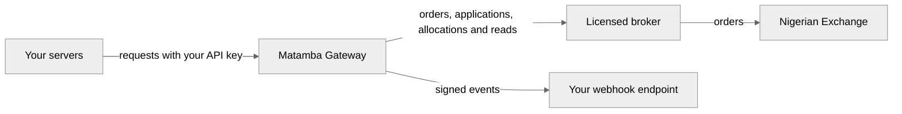

<!-- Generated by scripts/generate.py from the Matamba Gateway partner docs. Do not edit: change the docs and run the script. -->

# How it works / Versioning / Glossary

## How it works

Source: <https://docs.matambaintelligence.com/how-it-works>

You send requests to the gateway, and we route them to a licensed broker, which places orders on the Nigerian Exchange. We store each order before we send it to the exchange, and we send it only once. For the broker's name, [ask us](https://docs.matambaintelligence.com/support).

The broker holds your customers' accounts, their cash and their shares, and the money you pay in sits in the broker's client bank account. We keep your wallet's ledger, and we record each order, application and allocation before we send it on. A request we refuse before that point leaves no record.

| Concept | What to know |
|---|---|
| Authentication | Send your API key in the `Authorization` header as `Bearer $KEY`. Sandbox keys start with `mgw_test_` and live keys start with `mgw_live_`. Each key works only in its own environment. |
| Amounts | Amounts are integers in kobo, the smallest unit of the naira. For example, `47500` is ₦475.00. A field ending in `_kobo_decimal`, such as an average price, is a decimal string of kobo. |
| Idempotency | Requests that create an order, an application or an allocation require an `Idempotency-Key` header. Once we've stored a request, a retry with the same key answers about that request instead of making a duplicate. |
| Errors | Every error has the same JSON shape. Use the `code` field in your logic. The `message` field is written for people and can change. See the [error reference](https://docs.matambaintelligence.com/errors). |
| Events | Each change to an order, an application or an allocation creates an event. List events with `GET /v1/events`, or receive them at your webhook endpoint. See [Webhooks](https://docs.matambaintelligence.com/webhooks). |
| Lists | Every list has the same envelope: `data`, `has_more` and `next_cursor`. A list that takes `limit` and `cursor` comes a page at a time: pass `limit` for its size, and `next_cursor` as `cursor` for the next page. Stop when `has_more` is false, and keep the same filters on every page. A list that takes neither comes complete, with `has_more` always false. See [Fixed limits](https://docs.matambaintelligence.com/limits#fixed-limits). |

To go further, read about [orders](https://docs.matambaintelligence.com/orders), [idempotency](https://docs.matambaintelligence.com/idempotency), your [wallet](https://docs.matambaintelligence.com/wallet) and [webhooks](https://docs.matambaintelligence.com/webhooks). The terms these pages use are in the [glossary](https://docs.matambaintelligence.com/glossary).

> **Note.**
> The sandbox has its own host and its own API keys. It uses test money and doesn't connect to the exchange.

## Versioning

Source: <https://docs.matambaintelligence.com/versioning>

The version is in the path. Every endpoint today is under `/v1`.

### Changes we make within a version

We add to `v1` without advance notice, and each addition is in the [changelog](https://docs.matambaintelligence.com/changelog). Build your integration so these changes don't break it:

| Change | What your code should do |
|---|---|
| A new endpoint | Nothing. |
| A new field in a response or an event | Ignore fields you don't use. Don't fail on fields you don't recognise. |
| A new event type | Ignore types you don't handle. |
| A new value in a list of values, such as an order state, a `reject_reason` or an error `code` | Handle an unknown value with a safe default. If you generate a client from our OpenAPI file, have it accept values it doesn't know: in OpenAPI Generator, set `enumUnknownDefaultCase` to `true`. |
| A new optional request field | Nothing. |
| New wording in `message` or `reason` | Nothing. These are for people to read, so never match on them. |

### Breaking changes

From the first live release, these changes never happen within a version:

- removing or renaming an endpoint, a field or a value,
- changing a field's type or meaning,
- making an optional request field required,
- changing the status code or error `code` for an outcome.

Before the first live release, the sandbox can still change in these ways. The [changelog](https://docs.matambaintelligence.com/changelog) marks each such change as breaking.

A breaking change comes in a new version, such as `/v2`. We tell you at least 12 months before a version stops working, and the old and new versions run side by side for at least 12 months, so you can move when it suits you. We tell you by email, at the [technical contact](https://docs.matambaintelligence.com/support#what-to-send-for-each-request) you gave us, and in the [changelog](https://docs.matambaintelligence.com/changelog).

## Glossary

Source: <https://docs.matambaintelligence.com/glossary>

The terms these pages use, in alphabetical order.

| Term | Meaning |
|---|---|
| Account | A customer's brokerage account at the broker, named by its account code. See [Open an account](https://docs.matambaintelligence.com/applications). |
| Allocation | A move of money from your wallet to one account. See [Wallet](https://docs.matambaintelligence.com/wallet). |
| Application | A request to open an account for a customer. See [Open an account](https://docs.matambaintelligence.com/applications). |
| Bank reference | The bank's own reference for one transfer, such as an instant transfer's session ID. A credit carries it as `bank_reference`. See [Find the credit](https://docs.matambaintelligence.com/funding#2-find-the-credit). |
| Bonus shares | Shares a company issues to its shareholders without payment. They're credited to the customer's CSCS account. See [Dividends and bonus shares](https://docs.matambaintelligence.com/orders#dividends-and-bonus-shares). |
| Booked | An allocation the broker has added to the account's balance. |
| Business day | A day from Monday to Friday. Our replies and payments count business days. If a Nigerian public holiday falls in the period, [ask us](https://docs.matambaintelligence.com/support) when to expect them. |
| BVN | Bank Verification Number: the number that identifies a customer across Nigerian banks. |
| Consideration | The value of the shares a trade exchanged: quantity times price, before charges. See [After a fill](https://docs.matambaintelligence.com/orders#after-a-fill). |
| Contract note | The broker's record of a settled trade, with its charges. See [After a fill](https://docs.matambaintelligence.com/orders#after-a-fill). |
| Credit | A payment of yours, recorded in your wallet. See [Fund an account](https://docs.matambaintelligence.com/funding). |
| CSCS | Central Securities Clearing System: the depository that holds the customer's shares, in an account in their name. |
| Cursor | Where a page of a list ends. Pass a response's `next_cursor` as `cursor` to get the next page. |
| Dividend | A company's payment to its shareholders. The company's registrar pays cash dividends into the bank account on the customer's e-dividend mandate, not through the API. See [Dividends and bonus shares](https://docs.matambaintelligence.com/orders#dividends-and-bonus-shares). |
| Estimate | What an order would cost or pay, from `POST /v1/orders/estimate`: the most a buy can cost, never a price to show. See [Estimate the order](https://docs.matambaintelligence.com/trade#2-estimate-the-order). |
| Delivered | A document the broker has: the answer to [`PUT /v1/applications/{id}/documents/{type}`](https://docs.matambaintelligence.com/applications#send-the-documents). It doesn't mean the broker's staff have verified it. |
| Document | One of the four files the broker needs for an application: a passport photograph, a government-issued ID, a utility bill and a signature. See [Send the documents](https://docs.matambaintelligence.com/applications#send-the-documents). |
| ETF | An exchange-traded fund. The broker takes limit orders only for an ETF, never a market order. See [Order types](https://docs.matambaintelligence.com/orders#order-types). |
| Event | A record of a change to an order, an application or an allocation. See [Webhooks](https://docs.matambaintelligence.com/webhooks). |
| Exchange, in error codes | Codes named `exchange_*` and `cancel_unconfirmed` are about our connection to the broker, which places orders on the exchange. |
| Expired | An order whose time in force ended before it filled. It's final. See [Order states](https://docs.matambaintelligence.com/orders#order-states). |
| Gateway | The Matamba Gateway: the API you call, and the service behind it that records each request and sends it to the broker. The sandbox and live are separate gateways, each with its own host. |
| Idempotency key | The header that makes a retry safe: once we've stored a request, every retry with the same key answers about that request instead of making a duplicate. See [Idempotency](https://docs.matambaintelligence.com/idempotency). |
| Kobo | A hundredth of a naira. Amounts in the API are integers in kobo, so ₦475.00 is `47500`. A field ending in `_kobo_decimal`, such as `average_fill_price_kobo_decimal`, is a decimal string of kobo, exact; a whole-kobo figure beside one is it rounded, in the direction its field says. |
| LGA | Local Government Area, the level of government below a state. `lga_of_origin` takes a code from `GET /v1/reference/states/{state}/lgas`. |
| Live | The environment that trades real money on the exchange. |
| NIN | National Identification Number. |
| Operations team | Our staff who reconcile uncertain orders, applications and allocations with the broker and record what it confirms, and who record and approve your payout account and withdrawals, from 9:00 to 17:00 WAT, Monday to Friday. See [How it resolves](https://docs.matambaintelligence.com/handling-uncertain#how-it-resolves). |
| Partner | You: the company that uses the API, holds its keys and wallet, and opens accounts for its customers. |
| Partner portal | Our website where your staff sign in to see what your company did through the API. Its Administrators create, rotate and revoke your API keys, set your payout account and ask for withdrawals from your wallet. See [Keys and security](https://docs.matambaintelligence.com/keys-and-security#how-keys-are-created) and [Take money out](https://docs.matambaintelligence.com/wallet#from-your-wallet). |
| Payer reference | The reference we give you to put in every transfer's narration, so we know a payment is yours. It doesn't change. See [Fund an account](https://docs.matambaintelligence.com/funding). |
| Payout account | Your company's bank account on file, in your registered company name, that we pay withdrawals from your wallet to. One person on our operations team records it and a second approves it. See [From your wallet](https://docs.matambaintelligence.com/wallet#from-your-wallet). |
| Pending debits | Money the broker holds against an account, as the broker reports it: `pending_debits_kobo` on `GET /v1/accounts/{account}/balance`, rounded up to the whole kobo, and exact in `pending_debits_kobo_decimal`. In the sandbox, the cash held for open buy orders. |
| Position | The shares of one symbol an account holds, as the broker reports them in `GET /v1/accounts/{account}/positions`. |
| Post | A wallet ledger entry: the broker booked an allocation, so its reserved amount is now allocated. See [Read the ledger](https://docs.matambaintelligence.com/wallet#read-the-ledger). |
| Price limits | The band a security can trade in on the day. A market order is priced at its edge. See [Order types](https://docs.matambaintelligence.com/orders#order-types). |
| Reference | The broker's reference for an application, in its `reference` once the broker has it. See [Read the answer](https://docs.matambaintelligence.com/applications#3-read-the-answer). |
| Refused | Never reached the broker or the exchange. Compare rejected. |
| Registrar | The company that keeps a listed company's register of shareholders and pays its cash dividends. See [Dividends and bonus shares](https://docs.matambaintelligence.com/orders#dividends-and-bonus-shares). |
| Rejected | The broker or the exchange received it and refused it, or, for an allocation, our operations team confirmed the broker didn't book it. `reject_reason` says why. |
| Reserved | Money set aside in your wallet for an allocation that isn't yet booked. |
| Rights issue | An offer of new shares to a company's shareholders. The API doesn't take part. See [Rights issues](https://docs.matambaintelligence.com/orders#rights-issues). |
| Sandbox | The test environment: its own host and keys, test money, and no exchange. See [Sandbox](https://docs.matambaintelligence.com/sandbox#how-the-sandbox-behaves). |
| Scope | What a key may do: `read`, `trade`, `fund` or `apply`. See [Keys and security](https://docs.matambaintelligence.com/keys-and-security#scopes). |
| Settlement | The exchange of shares and cash after a trade. Equities settle one business day after the trade date (T+1). See [After a fill](https://docs.matambaintelligence.com/orders#after-a-fill). |
| Settlement lockout | A window while the day's trades settle, when the broker can refuse orders, estimates, allocations and reads. See [Trading hours](https://docs.matambaintelligence.com/orders#trading-hours). |
| Technical contact | The person at your company who receives our notices and one-time links, and whose requests to take money out of a customer's account we act on. See [Get access and support](https://docs.matambaintelligence.com/support). |
| Ticket | The broker's number for one trade. A contract note carries the `ticket` of its trade. See [After a fill](https://docs.matambaintelligence.com/orders#after-a-fill). |
| Time in force | How long an order stays open: `day`, `gtc`, `ioc` or `fok`. See [Time in force](https://docs.matambaintelligence.com/orders#time-in-force). |
| Trade | The broker's record of a fill, in `GET /v1/accounts/{account}/trades`. See [After a fill](https://docs.matambaintelligence.com/orders#after-a-fill). |
| Uncertain | Sent, and its receipt not confirmed. We never resubmit it, and our operations team reconciles it. See [Handle an uncertain result](https://docs.matambaintelligence.com/handling-uncertain). |
| Unplaced | An application the broker does not hold: it never received it, refused it with a reason it doesn't publish, or no longer holds it. Our operations team records it. It's final. See [Application states](https://docs.matambaintelligence.com/applications#application-states). |
| Unresolved | An order or an allocation that is `uncertain`, or still `sending` after its request has ended. Its outcome at the broker is not recorded yet. See [Identical orders](https://docs.matambaintelligence.com/handling-uncertain#identical-orders-while-one-is-unresolved) and [Identical allocations](https://docs.matambaintelligence.com/handling-uncertain#identical-allocations-while-one-is-unresolved). |
| Void | A wallet ledger entry: an allocation didn't book, so its amount is returned to your wallet. See [Read the ledger](https://docs.matambaintelligence.com/wallet#read-the-ledger). |
| Wallet | Our ledger of the money you've paid in, what you've allocated from it, and what you've withdrawn. See [Wallet](https://docs.matambaintelligence.com/wallet). |
| WAT | West Africa Time, Nigeria's time zone: one hour ahead of UTC all year. Times of day on these pages are WAT. Timestamps in the API are UTC, and dates such as `trade_date` are WAT days. |
| Webhook endpoint | Your HTTPS URL that receives events. See [Webhooks](https://docs.matambaintelligence.com/webhooks). |
| Withdrawal | Money out of your wallet to your payout account, which your partner portal's Administrators ask for in the portal. Money out of a customer's account is a separate request, which you [ask us](https://docs.matambaintelligence.com/support) for by email. Neither can be asked for through the API. See [Take money out](https://docs.matambaintelligence.com/wallet#take-money-out). |
| Withdrawing | Money held from your wallet for a withdrawal we've recorded and not yet paid: `withdrawing_kobo` on `GET /v1/wallet`. See [Take money out](https://docs.matambaintelligence.com/wallet#from-your-wallet). |
| Withdrawn | Money paid from your wallet to your payout account, less any your bank sent back: `withdrawn_kobo` on `GET /v1/wallet`. See [Take money out](https://docs.matambaintelligence.com/wallet#from-your-wallet). |
