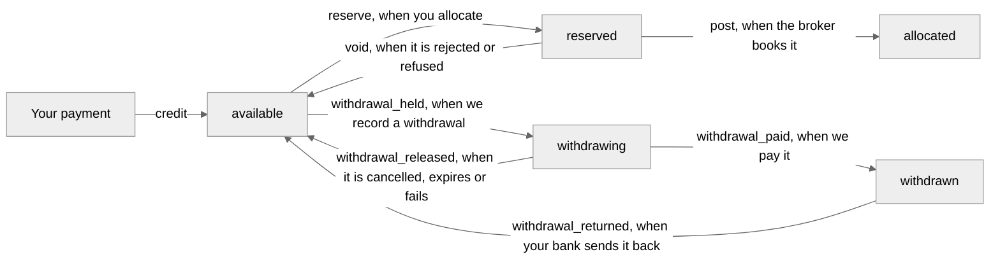

<!-- Generated by scripts/generate.py from the Matamba Gateway partner docs. Do not edit: change the docs and run the script. -->

# Fund an account / Wallet

## Fund an account

Source: <https://docs.matambaintelligence.com/funding>

You fund a customer's account in two moves: you pay into your wallet, and then you allocate from your wallet to the account. The customer can trade once the allocation is booked.

### 1. Pay into your wallet

Pay by bank transfer. There's no API call for this step. We send you the bank, account name, account number and your payer reference by email from partners@matambaintelligence.com when we set up your live access. They don't change. Put your payer reference in each transfer's narration, so we know the payment is yours. If anyone asks you to pay into a different account, don't pay: confirm it with us first, at the address on [Get access and support](https://docs.matambaintelligence.com/support), never at one given in the request.

We credit your wallet the same business day we confirm your payment as received, during support hours: 9:00 to 17:00 West Africa Time (WAT), Monday to Friday. There's no event for a credit, so look for it in `GET /v1/wallet/transfers`.

In the sandbox there's no bank. Your sandbox wallet opens with ₦10,000,000.00 of test money when we set up your sandbox access, credited once. For more, [ask us](https://docs.matambaintelligence.com/support#what-to-send-for-each-request). It's a `credit` in `GET /v1/wallet/transfers`, with a `bank_reference` that starts with `SANDBOXOPENINGCREDIT`. A restart of the sandbox doesn't reset your wallet.

### 2. Find the credit

The credit adds to `credited_kobo` and `available_kobo` on `GET /v1/wallet`, and appears in `GET /v1/wallet/transfers` as an entry of type `credit`:

```json Credit entry
{
  "object": "wallet_transfer",
  "id": "wtr_1",
  "type": "credit",
  "amount_kobo": 100000000,
  "available_change_kobo": 100000000,
  "allocation": null,
  "account": null,
  "bank_reference": "100004260924101500000123456789",
  "withdrawal": null,
  "created_at": "2026-09-24T09:30:00Z"
}
```

`bank_reference` is the bank's own reference for your transfer: for an instant transfer, its session ID, the long number on your transfer receipt; for another kind of transfer, the reference on your bank's receipt. It's different for every transfer, and it's shown in capitals with only its letters and digits. Match your payments to credits by it. We credit each bank reference once, however often the transfer is reported to us, so a payment is never counted twice.

If a payment doesn't appear, [send us](https://docs.matambaintelligence.com/support) its date, its amount and the bank's reference.

### 3. Allocate to the account

Send `POST /v1/allocations` with the account and the amount, and a new [`Idempotency-Key`](https://docs.matambaintelligence.com/idempotency):

```http Request
POST /v1/allocations
Authorization: Bearer $KEY
Content-Type: application/json
Idempotency-Key: alloc-0001

{
  "account": "$ACCOUNT",
  "amount_kobo": 5000000
}
```

```bash cURL
curl -X POST https://$HOST/v1/allocations \
  -H "Authorization: Bearer $KEY" \
  -H "Content-Type: application/json" \
  -H "Idempotency-Key: alloc-0001" \
  --data-binary @- <<EOF
{
  "account": "$ACCOUNT",
  "amount_kobo": 5000000
}
EOF
```

```http Response
HTTP/1.1 201 Created

{
  "object": "allocation",
  "id": "alc_4hn7vz2qe6wk3pma5rtd",
  "account": "$ACCOUNT",
  "amount_kobo": 5000000,
  "state": "booked",
  "reason": null,
  "reject_reason": null,
  "created_at": "2026-09-25T06:07:15Z",
  "updated_at": "2026-09-25T06:07:15Z",
  "client_reference": null
}
```

We reserve the amount in your wallet, then send the allocation to the broker once. `booked` means the amount is in the account's balance at the broker, and you also receive an `allocation.booked` [event](https://docs.matambaintelligence.com/webhooks). Read the balance with `GET /v1/accounts/{account}/balance`.

| Response | What to do |
|---|---|
| `201` with `state` `booked` | Nothing. The customer can trade. |
| `201` with `state` `uncertain` | Wait. The amount stays reserved while it is reconciled with the broker. See [Handle an uncertain result](https://docs.matambaintelligence.com/handling-uncertain#applications-and-allocations). |
| `503 outcome_not_recorded` | Its outcome was not recorded. Retrieve the allocation the error's `allocation` names until it resolves. Don't send it again under a new key. |
| The allocation still reads `sending` after your request has ended | Its outcome was not recorded. We send a `201`, `403 feature_not_enabled`, `422 allocation_rejected` or `503 allocation_not_sent` only once the outcome is recorded, so this never follows one of them. The amount stays reserved, and another allocation to the same account for the same amount is refused until it resolves. Don't send it again under a new key. Our operations team reconciles it with the broker, and it becomes `booked`, or `rejected` with `reject_reason` `not_booked` and the amount returned to your wallet. See [Identical allocations](https://docs.matambaintelligence.com/handling-uncertain#identical-allocations-while-one-is-unresolved). |
| `422 allocation_rejected` | Act on its [`reject_reason`](https://docs.matambaintelligence.com/errors#allocation_reject_reasons). The amount has been returned to your wallet. |
| `422 wallet_too_low` | Pay in more, then send it again. Nothing was stored, so you can reuse the key. |
| `503 allocation_not_sent` | Send it again with a new key. The amount has been returned to your wallet. |
| `409 similar_allocation_unresolved` | Nothing was stored. Retrieve the allocation the error's `allocation` names until it resolves. If it becomes `booked`, the account is funded: send yours again with the same key only if it is a separate allocation, not a repeat of that one. If it becomes `rejected`, send yours again with the same key. See [Identical allocations](https://docs.matambaintelligence.com/handling-uncertain#identical-allocations-while-one-is-unresolved). |

Every other refusal, and whether each one stored your key, is in [Idempotency](https://docs.matambaintelligence.com/idempotency#when-to-use-a-new-key).

### Check your wallet adds up

`available_kobo` always equals `credited_kobo` minus `allocated_kobo`, `reserved_kobo`, `withdrawing_kobo` and `withdrawn_kobo`, and the `available_change_kobo` of every ledger entry adds up to `available_kobo`. See [Wallet](https://docs.matambaintelligence.com/wallet) for what each figure and each entry means.

## Wallet

Source: <https://docs.matambaintelligence.com/wallet>

Your wallet is our ledger of the money you've paid in to fund your customers' accounts. The money itself sits in the broker's client bank account. You move money from it to one account at a time with an allocation. To do it step by step, see [Fund an account](https://docs.matambaintelligence.com/funding).

### How money moves

A payment of yours becomes a `credit` to your wallet. An allocation reserves its amount, and we send it to the broker once. If the broker books it, the amount is posted to the account. If not, the amount returns to your wallet. We check your wallet and reserve the amount in one step, so two allocations can never both spend the same money. A withdrawal to your company's bank account is held from your wallet the same way. See [Take money out](https://docs.matambaintelligence.com/wallet#take-money-out).



| Allocation state | Your wallet |
|---|---|
| `sending` | We've stored it and are sending it to the broker. You normally see it only while your request is in progress. The amount is reserved. If it still reads `sending` after its request has ended, its outcome was not recorded. Our operations team reconciles it with the broker as it does an `uncertain` allocation, and it becomes `booked`, or `rejected` with `reject_reason` `not_booked` and the amount returned to your wallet. Until then, another allocation to the same account for the same amount is refused. |
| `booked` | The broker booked the amount into the account's balance. It moves from reserved to allocated. |
| `uncertain` | The broker did not confirm whether it booked the allocation. The amount stays reserved while it is reconciled with the broker. Until then, another allocation to the same account for the same amount is refused. See [how it resolves](https://docs.matambaintelligence.com/handling-uncertain#applications-and-allocations) and [Identical allocations](https://docs.matambaintelligence.com/handling-uncertain#identical-allocations-while-one-is-unresolved). |
| `rejected` | The broker rejected it, or our operations team confirmed it didn't book it. `reject_reason` says which. The amount returns to available. |
| `refused` | It never reached the broker. The amount returns to available. |

If your wallet doesn't hold the amount, you get `422 wallet_too_low` and nothing is stored. One allocation and your allocations each day both have a cap. See [Limits](https://docs.matambaintelligence.com/limits).

### The figures

`GET /v1/wallet` returns six figures, all read from your wallet's ledger at the same moment:

| Field | Meaning |
|---|---|
| `credited_kobo` | Everything credited to your wallet from your confirmed payments. |
| `allocated_kobo` | Everything booked into your accounts at the broker. |
| `reserved_kobo` | Allocations we've sent that aren't yet confirmed as booked. |
| `withdrawing_kobo` | Withdrawals we've recorded and not yet paid. See [Take money out](https://docs.matambaintelligence.com/wallet#take-money-out). |
| `withdrawn_kobo` | Withdrawals paid to your payout account, less any your bank sent back. |
| `available_kobo` | What you can allocate or withdraw now. |

This always holds:

`available_kobo` = `credited_kobo` minus `allocated_kobo`, `reserved_kobo`, `withdrawing_kobo` and `withdrawn_kobo`

```json Example
{
  "object": "wallet",
  "credited_kobo": 100000000,
  "allocated_kobo": 5000000,
  "reserved_kobo": 0,
  "withdrawing_kobo": 2000000,
  "withdrawn_kobo": 3000000,
  "available_kobo": 90000000
}
```

The ledger behind these figures is append-only. Credits, reserves, bookings, withdrawals and returns are added as new entries, and nothing is ever changed or deleted.

### Read the ledger

`GET /v1/wallet/transfers` lists every entry, newest first, a page at a time. Each entry says what it did to `available_kobo`:

| `type` | When | `available_change_kobo` |
|---|---|---|
| `credit` | We confirmed a payment of yours. `bank_reference` names it. | Plus the amount |
| `reserve` | You made an allocation, and we set its amount aside. | Minus the amount |
| `post` | The broker booked the allocation. `account` names the account. | Zero |
| `void` | The allocation didn't book. The amount returns to available. | Plus the amount |
| `withdrawal_held` | We recorded your withdrawal and set its amount aside. `withdrawal` names it. | Minus the amount |
| `withdrawal_paid` | We paid the withdrawal to your payout account. | Zero |
| `withdrawal_released` | The withdrawal was cancelled, expired or failed before it was paid. The amount returns to available. | Plus the amount |
| `withdrawal_returned` | Your bank sent a paid withdrawal back. The amount returns to available. | Plus the amount |

Adding up `available_change_kobo` over every entry gives `available_kobo`. Every withdrawal entry's `withdrawal` names its withdrawal, as your partner portal shows it. No webhook event is sent for a wallet entry: read them here.

### Your wallet and an account's balance

An account's balance, unlike your wallet, is the broker's: `GET /v1/accounts/{account}/balance` returns it as the broker reports it. After an allocation is booked, the amount shows in the account's balance, and trades and charges then move that balance at the broker.

### Take money out

#### From your wallet

You can withdraw up to your `available_kobo` to your company's bank account, from ₦100.00 to ₦100,000,000.00 each time. It's free. There is no withdrawal endpoint in the API: your [partner portal](https://docs.matambaintelligence.com/glossary)'s Administrators set the account and ask for each withdrawal there. If no one at your company can sign in to the portal, [contact us](https://docs.matambaintelligence.com/support).

1. **Set your payout account.** An Administrator enters the bank, the 10-digit account number and the account name. It must be a corporate account whose name is your registered company name, word for word: `LTD` and `LIMITED` are different words. We confirm it by calling a contact already on record. One person on our operations team records it and a second approves it. We pay only this account, never one named in an email, a call or any other message.
2. **Ask for a withdrawal** in the portal, with the amount and your own reference for the request, in letters and digits. We ignore case, spaces and punctuation, so `WD-1` and `wd 1` are the same reference. Asking again with the same reference doesn't make a second withdrawal, and a reference names one withdrawal for good: to ask again after one is released, use a new reference.
3. **We record it and hold the amount.** Our operations team records requests from 9:00 to 17:00 West Africa Time (WAT), Monday to Friday. Until then, the amount is still in `available_kobo`, and an allocation can still spend it. When we record it, the amount moves from `available_kobo` to `withdrawing_kobo`, with a `withdrawal_held` entry in your ledger. If your wallet doesn't hold the amount then, nothing is held and the withdrawal isn't made.
4. **We approve it and pay it.** A second person on our operations team, never the one who recorded it, approves it, and we pay it by the end of the next business day after that approval. A `withdrawal_paid` entry follows, and the amount moves from `withdrawing_kobo` to `withdrawn_kobo`. The portal shows the bank's reference for the payment, to trace it with your bank.

| If | Then |
|---|---|
| You change your payout account | From the moment we approve the change, we pay only the new account, and approve no withdrawal to it until 3 whole business days have passed. The portal shows the date it can first be paid. A withdrawal recorded to the old account and not yet approved isn't paid. Its amount stays in `withdrawing_kobo` until we cancel it, or 7 days after we recorded it, with a `withdrawal_released` entry: ask for it again, under a new reference. One we approved before the change may already be on its way to the old account. If it must not be paid there, [contact us](https://docs.matambaintelligence.com/support) at once. |
| We don't approve a request within 7 days of recording it | It's released with a `withdrawal_released` entry, and the amount returns to `available_kobo`. No money moved. |
| You want to cancel a withdrawal | [Contact us](https://docs.matambaintelligence.com/support) before it's paid, with its `wdr_` ID, or your reference if the portal shows no ID yet. It's released with a `withdrawal_released` entry. A paid withdrawal can't be cancelled. |
| The payment doesn't reach your bank | It's released with a `withdrawal_released` entry. Until an Administrator enters your payout account again and we approve it, as in step 1, we can't record a withdrawal. |
| Your bank sends a paid withdrawal back | Once two people on our operations team match it to our bank statement, the amount returns to `available_kobo` with a `withdrawal_returned` entry, and `withdrawn_kobo` falls by it. `credited_kobo` doesn't change. |

#### From a customer's account

Money out of a customer's account is a separate request. Your technical contact emails [partners@matambaintelligence.com](mailto:partners@matambaintelligence.com), the address on [Get access and support](https://docs.matambaintelligence.com/support), and we take the request to the broker. We act only on a request from the technical contact on record, and we confirm it by replying to that contact before we act. We pay within two business days of the request.

| To take out | Include |
|---|---|
| Money from a customer's account, such as a sale's proceeds | The account code and the amount. We pay it only to the bank account in the customer's own name on the broker's record. |

Our reply confirms the request.
