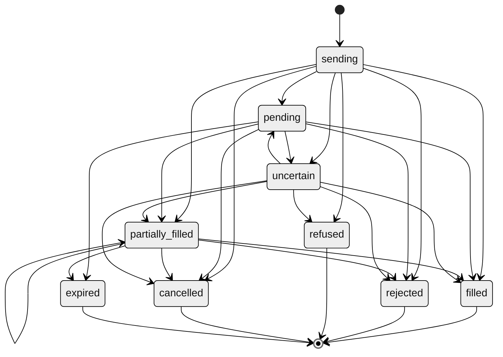

<!-- Generated by scripts/generate.py from the Matamba Gateway partner docs. Do not edit: change the docs and run the script. -->

# Trade for a customer / Orders

## Trade for a customer

Source: <https://docs.matambaintelligence.com/trade>

Once a customer's account is open and funded, you trade for it with orders. This page takes one order from its symbol to its contract note. [Orders](https://docs.matambaintelligence.com/orders) explains the states, order types and times in force it meets on the way.

### 1. Find the symbol

There's no endpoint that lists symbols. The exchange publishes its own lists, by symbol: its [listed companies](https://ngxgroup.com/exchange/trade/equities/listed-companies/) and its [exchange-traded products](https://ngxgroup.com/exchange/trade/exchange-traded-funds/listed-etp/).

Before we store a market order or a sell, we check its symbol against the broker's price list. A symbol that isn't on it is refused with [`422 unknown_symbol`](https://docs.matambaintelligence.com/errors#unknown_symbol), and nothing is stored. A limit buy isn't checked first: it's sent, and if the broker doesn't list the symbol, it comes back `rejected` with `reject_reason` `unknown_symbol`. The sandbox lists only its own few symbols: see the [sandbox reference](https://docs.matambaintelligence.com/sandbox).

#### Prices to show your customers

The API gives no prices or quotes. To show your customers prices, use a licensed market data source: the exchange's data portal or a registered data vendor. The prices on the exchange's own [price list](https://ngxgroup.com/exchange/data/equities-price-list/) page are delayed by 30 minutes.

For a symbol the account holds, `GET /v1/accounts/{account}/positions` gives `market_price_kobo`, the broker's figure, and `market_value_kobo`, the position's worth at that price.

Never show an estimate as a price. It's the most an order can cost: a market buy is priced at the day's upper limit, plus charges.

### 2. Estimate the order

`POST /v1/orders/estimate` takes the same body as `POST /v1/orders` and returns `estimated_total_kobo` without placing or storing anything. The broker's charges run to fractions of a kobo: `estimated_total_kobo_decimal` is the estimate exact, and `estimated_total_kobo` is it rounded to the whole kobo: up for a buy, down for a sell. For a buy, it's the estimated cost. For a sell, it's the estimated proceeds. The figure is the broker's estimate: it includes the consideration, statutory charges and commission, and it's indicative. An estimate meets neither daily limit and still works while trading is paused. A symbol the broker doesn't list comes back `422 order_rejected` with `reject_reason` `unknown_symbol`, not `422 unknown_symbol`.

A market order is priced at the day's price limit, so a market buy's estimate uses the upper limit, which nothing trades above. The [quickstart](https://docs.matambaintelligence.com/quickstart) works one out.

Before a market buy, check that the account's `available_kobo` covers the estimate's `estimated_total_kobo`, not the cost you expect at the fill. Both round against the customer, so the check never passes when the account can't pay; for the exact check, compare `available_kobo_decimal` with `estimated_total_kobo_decimal`: we send the order to the broker at the upper limit. If you fund the account first, allocate at least the estimate. In the sandbox, a buy the balance can't cover at that price gets `422 order_rejected` with `reject_reason` `insufficient_funds`.

### 3. Place the order

Send `POST /v1/orders` with the same body and a new [`Idempotency-Key`](https://docs.matambaintelligence.com/idempotency). The [quickstart](https://docs.matambaintelligence.com/quickstart) shows the request and its answer. [Order types](https://docs.matambaintelligence.com/orders#order-types) says when to send `limit` and when `market`.

If the answer is `503 outcome_not_recorded`, the order the error's `order` names reads `sending` until it resolves, as an [uncertain](https://docs.matambaintelligence.com/handling-uncertain) order does. Retrieve it, or wait for its event, and don't place it again under a new key. [Idempotency](https://docs.matambaintelligence.com/idempotency#when-to-use-a-new-key) lists every other answer.

Send a market order as `day`, never `gtc`: [Time in force](https://docs.matambaintelligence.com/orders#time-in-force) says why.

#### Sell only what the account holds

Before a sell, read `GET /v1/accounts/{account}/positions`, and sell no more than the position's `quantity`.

In live, the broker publishes no refusal for a sell of more shares than the account holds. If it refuses one with a reason it doesn't publish, the order is `uncertain` until our operations team reconciles it: see [Handle an uncertain result](https://docs.matambaintelligence.com/handling-uncertain). In the sandbox such a sell doesn't fill: an `ioc` or `fok` order expires at once, a `day` order expires at midnight West Africa Time (WAT), and a `gtc` order stays open until the sandbox restarts, when it ends `expired`. A market sell cannot be cancelled: only a limit order can.

### 4. Follow the order

We check the broker for changes to your open orders about every 30 seconds. Each change sends an [event](https://docs.matambaintelligence.com/webhooks), or you can retrieve the order with `GET /v1/orders/{id}`. The order is finished once it's `filled`, `rejected`, `refused`, `cancelled` or `expired`. [Order states](https://docs.matambaintelligence.com/orders#order-states) explains each.

If it's `uncertain`, or still `sending` after its request has ended, don't place it again under a new key. See [Handle an uncertain result](https://docs.matambaintelligence.com/handling-uncertain).

### 5. Cancel an order

Send `DELETE /v1/orders/{id}`. You can cancel only a limit order that is `pending` or `partially_filled`.

| Response | Meaning | What to do |
|---|---|---|
| `202` | The broker accepted the cancel request. The order isn't cancelled yet. The body shows the order as it was before the cancel. | Wait for `order.cancelled`, or `order.filled` if the order filled first. |
| `409 order_not_cancelable` | The order is a market order, is in a final state, isn't yet confirmed at the exchange, or the broker refused the cancel. | Retrieve the order to see its state. |
| `503 exchange_unavailable` | We didn't send the cancel. | Send it again. |
| `503 cancel_unconfirmed` | The broker did not confirm receipt of the cancel. | Send it again. Repeating a cancel is safe. |

### 6. Read what it cost

Each fill becomes a trade in `GET /v1/accounts/{account}/trades`, carrying your order's `order_id`. Once the trade settles, its contract note appears in `GET /v1/accounts/{account}/contract-notes` with the charges, matched to the trade by `ticket`. [After a fill](https://docs.matambaintelligence.com/orders#after-a-fill) explains each figure and when each appears.

### Then take money out

A customer's money is paid out of their account on request, not through the API. See [From a customer's account](https://docs.matambaintelligence.com/wallet#from-a-customers-account).

## Orders

Source: <https://docs.matambaintelligence.com/orders>

When you place an order, we store it, send it to the exchange once, and then track it until it reaches a final state. Every change creates an [event](https://docs.matambaintelligence.com/webhooks).

### Order states

| State | Meaning | Final |
|---|---|---|
| `sending` | We've stored the order and are sending it. You normally see this only while your request is in progress. If it still reads `sending` after its request has ended, its outcome was not recorded: it resolves as an `uncertain` order does, and an identical order is refused until then. | No |
| `pending` | The exchange has the order, and nothing has traded yet. | No |
| `partially_filled` | Some shares have traded. `filled_quantity` says how many. | No |
| `filled` | All shares have traded. | Yes |
| `uncertain` | We sent the order, and the exchange did not confirm receipt. We never resubmit it. See [Handle an uncertain result](https://docs.matambaintelligence.com/handling-uncertain). | No |
| `rejected` | The broker or the exchange rejected the order. `reject_reason` says why. | Yes |
| `refused` | It never reached the exchange: we refused it before sending, or our operations team confirmed the exchange never received it. You can place it again with a new `Idempotency-Key`. | Yes |
| `cancelled` | The exchange confirmed a cancel. | Yes |
| `expired` | Its time in force ended before it filled. | Yes |

An order that ends as `cancelled`, `expired` or `rejected` can have a `filled_quantity` above zero: shares that traded before it ended. We record those fills first, so you receive an `order.partially_filled` event before the final one.

New states can be added. Treat a state you don't recognise as not final, and retrieve the order again later. See [Versioning](https://docs.matambaintelligence.com/versioning).

### Trading hours

The exchange's equities market opens for order entry at 9:00 a.m. and trades continuously from 9:30 a.m. until the pre-close at 3:50 p.m. It closes at 4:00 p.m. All times are West Africa Time (WAT). The exchange sets these hours and publishes them on its [market structure page](https://ngxgroup.com/exchange/trade/equities/trading-market-structure/). We don't set them, and there's no endpoint that says whether the market is open now.

The exchange doesn't trade on Nigerian public holidays. It lists them on its [trading holidays page](https://ngxgroup.com/exchange/trade/becoming-an-investor/trading-holidays/), and the dates follow the Federal Government's announcements.

An order the broker can't take because the market is closed comes back as `422 order_rejected` with `reject_reason` `market_closed`. Send it again with a new `Idempotency-Key` when the market opens.

While the day's trades settle, the broker can refuse requests. It publishes this settlement lockout for placing an order, an estimate and the account's balance, and for withdrawals, which aren't in the API yet. If the broker sends it on any other read, or on an allocation, we pass it on too:

| Refused | You get | What to do |
|---|---|---|
| An order or an estimate | `422 order_rejected` with `reject_reason` `settlement_lockout` | Wait 60 seconds, as a read's `Retry-After` says, then send it again. An order needs a new `Idempotency-Key`. |
| An allocation | `422 allocation_rejected` with `reject_reason` `settlement_lockout` | Wait 60 seconds, then send it again with a new `Idempotency-Key`. The amount has been returned to your wallet. |
| A read, such as the balance | `503 settlement_lockout` | Send the request again after the `Retry-After` interval. |

The broker doesn't specify when in the day this window falls or how long it lasts.

### Order types

| `type` | Use it for | Price |
|---|---|---|
| `limit` | Any security. The only type an ETF takes. | Send `price_kobo`, the limit price per share. |
| `market` | Any security except an ETF. | Leave out `price_kobo`. We price the order at the day's price limit: the upper limit for a buy, the lower limit for a sell. |

The broker takes limit orders only for an ETF. A market order on an ETF is rejected with `422 order_rejected` and `reject_reason` set to `etf_limit_orders_only`. The order is stored as `rejected`, so place a limit order with a new `Idempotency-Key`. Shares take both types.

There's no endpoint that lists which symbols are ETFs. The exchange lists them on its [listed ETPs page](https://ngxgroup.com/exchange/trade/exchange-traded-funds/listed-etp/). In the sandbox, the only ETF is `STANBICETF30`.

### Time in force

| `time_in_force` | Meaning |
|---|---|
| `day` | Good for the current trading session only. |
| `gtc` | Good till cancelled. |
| `ioc` | Immediate or cancel. |
| `fok` | Fill or kill. |

These are the broker's own definitions. We accept either `type` with any `time_in_force`: the broker publishes no combination it refuses. If it refuses an order's type or time in force as invalid, the order is `rejected` with `reject_reason` `rejected_by_exchange`. Sending the same order again will not change the result: [contact us](https://docs.matambaintelligence.com/support) with its `id`. If the broker refuses an order with a reason it doesn't publish, the order is `uncertain` until our operations team reconciles it.

Only a limit order can be cancelled: the broker takes cancels for limit orders only. A market order sent `gtc` that doesn't fill stays open, and there's no way to cancel it through the API, so send market orders as `day`. If one stays open, [contact us](https://docs.matambaintelligence.com/support) with its `id`.

When the broker reports an order expired, we record it as `expired` on our next check. The broker doesn't specify when an unfilled `day` order expires, or how an `ioc` or `fok` order that doesn't fill at once ends.

In the sandbox, an `ioc` or `fok` order that doesn't fill at once ends `expired`. See [how the sandbox behaves](https://docs.matambaintelligence.com/sandbox#how-the-sandbox-behaves) for `day` and `gtc`. In live, each follows the broker.

### Fills

We check the broker for changes to your open orders about every 30 seconds. When an order fills, partly or fully, we record the change, and you receive the event within seconds of that. Expect a fill to reach you within about a minute of the trade. Fills between two checks arrive as one change, and an order that fills completely between two checks sends only `order.filled`, so read `filled_quantity`, not the number of events. You can also retrieve the order with `GET /v1/orders/{id}`, which returns what we've recorded and doesn't ask the broker.

| Field | What it holds |
|---|---|
| `filled_quantity` | The shares traded so far, in total. |
| `average_fill_price_kobo_decimal` | The average price of those shares, in kobo, before charges, as a decimal string such as `"12028.571428571429"`. Exact up to 12 decimal places; past that, rounded to the nearest, halves away from zero. Null until a share trades, or when the fills' prices are unavailable. |
| `filled_at` | When we recorded the order as `filled`. Null until then. |

Charges aren't on the order. The broker fixes them on the contract note, so read `GET /v1/accounts/{account}/contract-notes` for what an order cost.

### After a fill

A fill becomes a trade, the trade settles, and the broker issues a contract note for it:

| Step | What happens | Where you see it |
|---|---|---|
| Fill | The exchange matches some or all of the order. | The order's `filled_quantity`, and an `order.partially_filled` or `order.filled` event. |
| Trade | The broker records the fill as a trade. | `GET /v1/accounts/{account}/trades`. A trade of an order you placed through us carries its `order_id`. |
| Settlement | The trade settles one business day after the trade date. | Nothing to call. Equities on the exchange settle T+1, under the [SEC's circular](https://sec.gov.ng/for-investors/keep-track-of-circulars/transition-to-t1-settlement-cycle-in-the-nigerian-capital-market/) in force from 1 June 2026. |
| Contract note | The broker issues a contract note for the settled trade, with its charges. | `GET /v1/accounts/{account}/contract-notes`. |

The broker describes its contract notes as settled trades, so a trade's contract note appears once the trade settles, from the business day after the trade. In the sandbox, a trade shows at once, and its contract note appears from the next day, with a `transaction_date` one day after its `trade_date`.

When a sale's proceeds can pay for a buy or be taken out is the broker's decision: `available_kobo` on `GET /v1/accounts/{account}/balance` is what the account can spend. Sell no more than the position's `quantity`: the broker doesn't specify whether shares bought can be sold before they settle. In the sandbox, a sale's proceeds, less charges, are in the balance at once, and shares bought can be sold at once.

A contract note's `ticket` is the `ticket` of its trade, and the trade carries the `order_id` of your order. Match a note to its trade by `ticket` to find the order it belongs to.

What a contract note's figures mean:

| Field | Meaning |
|---|---|
| `consideration_kobo` | The value of the shares traded: `quantity` times `price_kobo`, before charges. |
| `commission_kobo`, `statutory_fees_kobo`, `other_fees_kobo` | The charges, as the broker reports them. |
| `amount_kobo` | The trade's amount, as the broker reports it and without a published definition: for what a trade cost or paid, use the sum below. In the sandbox it equals `consideration_kobo`. |

For what a buy cost, add the three charges to `consideration_kobo`. For what a sell paid, subtract them. The broker counts charges apart from the consideration: its estimate is the consideration plus statutory charges and commission.

The broker's charges can include fractions of a kobo, so each figure also comes exact, as a `_kobo_decimal` string: `commission_kobo_decimal` beside `commission_kobo`, and so on. The whole-kobo figures are rounded against the customer: the three charges up, and `amount_kobo` and `consideration_kobo` up on a buy and down on a sell. Each is rounded on its own, so for an exact total, add the `_kobo_decimal` figures.

A position's `average_cost_kobo_decimal` is the broker's average price for the shares held. The broker doesn't specify whether it includes charges. In the sandbox it doesn't.

### Dividends and bonus shares

Cash dividends don't pass through the API. The company's registrar pays them into the bank account on the customer's e-dividend mandate, which the [SEC introduced](https://sec.gov.ng/about/resources/forms/download-e-dividend-forms/) so shareholders are paid electronically.

Bonus shares are credited to the customer's CSCS account. They show in `GET /v1/accounts/{account}/positions` as the broker reports them.

### Rights issues

The API doesn't take part in a rights issue. A customer takes up their rights as the issue's own documents describe, through the registrar or a stockbroker. Shares allotted to them show in `GET /v1/accounts/{account}/positions` once the broker reports them. The API sends no notice of a rights issue. For a question about one on a customer's holding, [contact us](https://docs.matambaintelligence.com/support) with the account code.

### Your own reference

Send `client_reference` with an order, an application or an allocation to tag it with your own ID. We store it, return it on the object and its events, and let you filter a list by it: `GET /v1/orders?client_reference=ord-88213`. It's 1 to 64 printable ASCII characters with no spaces, and it isn't unique: several orders can share one. It's part of the request an `Idempotency-Key` stands for, so a retry with the same key and a different `client_reference` returns `409 duplicate_order`. Never put personal data in it.

`GET /v1/orders` also filters by `account`, `state` and `symbol`, each at most once, and the filters combine. Keep the same filters on every page of a list.

To place, estimate and cancel orders step by step, see [Trade for a customer](https://docs.matambaintelligence.com/trade).
